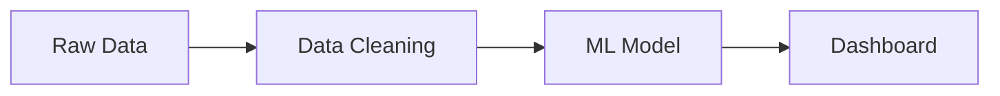

# สรุปคำสั่ง Markdown ที่ใช้บ่อยและสำคัญ (Markdown Cheat Sheet)

คู่มือสรุปไวยากรณ์ **Markdown** และ **GitHub Flavored Markdown (GFM)** สำหรับใช้เขียน `README.md`, เอกสารประกอบงาน, บันทึกแล็บ และ Jupyter Notebook

---

## สารบัญ

1. [หัวข้อ (Headings)](#1-หัวข้อ-headings)
2. [การจัดรูปแบบข้อความ (Text Formatting)](#2-การจัดรูปแบบข้อความ-text-formatting)
3. [รายการและเช็กลิสต์ (Lists & Task Lists)](#3-รายการและเช็กลิสต์-lists--task-lists)
4. [ลิงก์ รูปภาพ และ Badge (Links, Images & Badges)](#4-ลิงก์-รูปภาพ-และ-badge-links-images--badges)
5. [โค้ดและบล็อกโค้ด (Code & Code Blocks)](#5-โค้ดและบล็อกโค้ด-code--code-blocks)
6. [ตาราง (Tables)](#6-ตาราง-tables)
7. [ข้อความอ้างอิงและกล่องแจ้งเตือน (Blockquotes & Alerts)](#7-ข้อความอ้างอิงและกล่องแจ้งเตือน-blockquotes--alerts)
8. [เส้นคั่นและการ Escape อักขระพิเศษ](#8-เส้นคั่นและการ-escape-อักขระพิเศษ)
9. [คำสั่งขั้นสูงสำหรับ GitHub และ Data Science](#9-คำสั่งขั้นสูงสำหรับ-github-และ-data-science)
10. [ตารางสรุปเร็ว (Quick Reference)](#10-ตารางสรุปเร็ว-quick-reference)

---

## 1. หัวข้อ (Headings)

ใช้เครื่องหมาย `#` ตามด้วยเว้นวรรค 1 เคาะ (รองรับ 6 ระดับ จากใหญ่สุดไปเล็กสุด)

```markdown
# หัวข้อระดับ 1 (H1 - ใช้เป็นชื่อเอกสารหลัก)
## หัวข้อระดับ 2 (H2 - หัวข้อใหญ่)
### หัวข้อระดับ 3 (H3 - หัวข้อย่อย)
#### หัวข้อระดับ 4 (H4)
##### หัวข้อระดับ 5 (H5)
###### หัวข้อระดับ 6 (H6)
```

> **Tip:** ควรมี `#` (H1) เพียงอันเดียวต่อไฟล์ และเรียงลำดับระดับหัวข้อลงไป (`##` → `###`) เพื่อให้อ่านง่ายและสร้างสารบัญอัตโนมัติได้ดี

---

## 2. การจัดรูปแบบข้อความ (Text Formatting)

| รูปแบบ | คำสั่ง Markdown | ผลลัพธ์ |
| --- | --- | --- |
| **ตัวหนา (Bold)** | `**ข้อความ**` หรือ `__ข้อความ__` | **ข้อความ** |
| **ตัวเอียง (Italic)** | `*ข้อความ*` หรือ `_ข้อความ_` | *ข้อความ* |
| **ตัวหนาและเอียง** | `***ข้อความ***` | ***ข้อความ*** |
| **ขีดฆ่า (Strikethrough)** | `~~ข้อความ~~` | ~~ข้อความ~~ |
| **โค้ดในบรรทัด (Inline Code)** | `` `print("Hi")` `` | `print("Hi")` |
| **ตัวยก (Superscript)** | `X<sup>2</sup>` | X<sup>2</sup> |
| **ตัวห้อย (Subscript)** | `H<sub>2</sub>O` | H<sub>2</sub>O |
| **ขึ้นบรรทัดใหม่** | เว้นวรรค 2 ครั้งท้ายบรรทัด หรือใส่ `<br>` | ขึ้นบรรทัดใหม่ทันที |
| **ขึ้นย่อหน้าใหม่** | เว้นบรรทัดว่าง 1 บรรทัด | แยกเป็นย่อหน้าใหม่ |

---

## 3. รายการและเช็กลิสต์ (Lists & Task Lists)

### รายการแบบจุด (Unordered List)

ใช้ `-`, `*`, หรือ `+` (แนะนำใช้ `-` ให้เหมือนกันทั้งไฟล์) และย่อหน้า 2 หรือ 4 ช่องสำหรับรายการซ้อน

```markdown
- หัวข้อหลัก 1
- หัวข้อหลัก 2
  - หัวข้อย่อย 2.1
  - หัวข้อย่อย 2.2
    - หัวข้อย่อยลึกเข้าไปอีก
```

**ผลลัพธ์:**
- หัวข้อหลัก 1
- หัวข้อหลัก 2
  - หัวข้อย่อย 2.1
  - หัวข้อย่อย 2.2

### รายการแบบลำดับเลข (Ordered List)

```markdown
1. เตรียมข้อมูล (Data Preparation)
2. สำรวจข้อมูล (EDA)
3. สร้างแบบจำลอง (Modeling)
   1. แบ่งชุดข้อมูล Train / Test
   2. ประเมินผลโมเดล
```

**ผลลัพธ์:**
1. เตรียมข้อมูล (Data Preparation)
2. สำรวจข้อมูล (EDA)
3. สร้างแบบจำลอง (Modeling)

### เช็กลิสต์ (Task List)

เหมาะสำหรับติดตามสถานะงาน (GitHub / VS Code รองรับ)

```markdown
- [x] ติดตั้ง Python และสร้าง `.venv`
- [x] อัปโหลดไฟล์ขึ้น GitHub
- [ ] ทำความสะอาดข้อมูล (Data Cleaning)
```

**ผลลัพธ์:**
- [x] ติดตั้ง Python และสร้าง `.venv`
- [x] อัปโหลดไฟล์ขึ้น GitHub
- [ ] ทำความสะอาดข้อมูล (Data Cleaning)

---

## 4. ลิงก์ รูปภาพ และ Badge (Links, Images & Badges)

### ลิงก์ (Links)

```markdown
[ข้อความที่แสดง](https://github.com)
[ลิงก์พร้อมข้อความ Tooltip](https://github.com "ไปที่ GitHub")
[ลิงก์ไปยังหัวข้อในหน้าเดียวกัน](#6-ตาราง-tables)
[ลิงก์ไปยังไฟล์ในโปรเจกต์](./README.md)
```

### รูปภาพ (Images)

เหมือนลิงก์ แต่เติมเครื่องหมาย `!` ข้างหน้า

```markdown


```

หากต้องการกำหนดความกว้างของรูป ใช้แท็ก HTML แทน:

```html

```

### ป้ายสถานะ (Badges)

นิยมใช้กับ [Shields.io](https://shields.io) บนหัวไฟล์ `README.md`

```markdown


```

---

## 5. โค้ดและบล็อกโค้ด (Code & Code Blocks)

### โค้ดในบรรทัด (Inline Code)

ครอบด้วย Backtick 1 ตัว `` ` ``

```markdown
ใช้คำสั่ง `python -m venv .venv` เพื่อสร้าง Virtual Environment
```

### บล็อกโค้ดหลายบรรทัด (Fenced Code Block)

ครอบด้วย Backtick 3 ตัว ```` ``` ```` และระบุชื่อภาษาต่อท้ายเพื่อแสดงสีโค้ด (Syntax Highlighting)

````markdown
```python
import pandas as pd

df = pd.read_csv("data.csv")
print(df.head())
```
````

**ชื่อภาษาที่ใช้บ่อย:** `python`, `bash`, `powershell`, `sql`, `json`, `yaml`, `html`, `css`, `javascript`, `markdown`, `diff`, `text`

**ตัวอย่าง `diff` (แสดงบรรทัดที่เพิ่ม/ลบ):**

````markdown
```diff
- print("Old version")
+ print("New version")
```
````

---

## 6. ตาราง (Tables)

ใช้ `|` คั่นคอลัมน์ และใช้ `-` แยกแถวหัวตาราง โดยใส่ `:` เพื่อกำหนดการจัดตำแหน่งข้อความ

```markdown
| ชิดซ้าย (Default) | กึ่งกลาง | ชิดขวา |
| :--- | :---: | ---: |
| Python | 3.12 | 100 |
| Pandas | 2.2 | 250 |
```

**ผลลัพธ์:**

| ชิดซ้าย (Default) | กึ่งกลาง | ชิดขวา |
| :--- | :---: | ---: |
| Python | 3.12 | 100 |
| Pandas | 2.2 | 250 |

---

## 7. ข้อความอ้างอิงและกล่องแจ้งเตือน (Blockquotes & Alerts)

### ข้อความอ้างอิง (Blockquotes)

ใช้เครื่องหมาย `>` นำหน้าบรรทัด (ซ้อนได้ด้วย `>>`)

```markdown
> ข้อมูลที่ดีนำไปสู่การตัดสินใจที่ดี
>> อ้างอิงซ้อนอีกชั้น
```

**ผลลัพธ์:**
> ข้อมูลที่ดีนำไปสู่การตัดสินใจที่ดี
>> อ้างอิงซ้อนอีกชั้น

### กล่องแจ้งเตือนแบบ GitHub (GitHub Alerts)

แสดงกล่องสีเน้นข้อความสำคัญบน GitHub มี 5 รูปแบบ:

```markdown
> [!NOTE]
> ข้อมูลเพิ่มเติมที่ควรรู้

> [!TIP]
> เคล็ดลับหรือแนวทางที่แนะนำ

> [!IMPORTANT]
> ข้อมูลสำคัญที่ห้ามมองข้าม

> [!WARNING]
> คำเตือนที่ต้องระมัดระวัง

> [!CAUTION]
> ข้อควรระวังระดับสูง อาจเกิดความเสียหายได้
```

---

## 8. เส้นคั่นและการ Escape อักขระพิเศษ

### เส้นคั่นแนวนอน (Horizontal Rule)

ใช้เครื่องหมาย `-`, `*`, หรือ `_` อย่างน้อย 3 ตัวในบรรทัดเดียว (แนะนำ `---`)

```markdown
---
```

### การแสดงอักขระพิเศษไม่ให้ถูกแปลเป็นคำสั่ง (Escaping)

ใส่เครื่องหมาย Backslash `\` นำหน้าอักขระพิเศษ เช่น `\*`, `\#`, `\[`, `\]`, `` \` ``, `\|`

```markdown
\*ข้อความนี้จะไม่เป็นตัวเอียง\*
\# นี่ไม่ใช่หัวข้อ
```

**ผลลัพธ์:** \*ข้อความนี้จะไม่เป็นตัวเอียง\*

---

## 9. คำสั่งขั้นสูงสำหรับ GitHub และ Data Science

### 1) กล่องพับเก็บได้ (Collapsible Section)

ช่วยลดความยาวของหน้าเอกสาร เช่น ซ่อนโค้ดยาวๆ หรือรายละเอียดเสริม

```html
<details>
<summary><b>คลิกเพื่อดูรายละเอียดเพิ่มเติม</b></summary>
<br>

เนื้อหาด้านในสามารถเขียนเป็น **Markdown** ได้ตามปกติ

</details>
```

**ผลลัพธ์:**
<details>
<summary><b>คลิกเพื่อดูรายละเอียดเพิ่มเติม</b></summary>
<br>

เนื้อหาด้านในสามารถเขียนเป็น **Markdown** ได้ตามปกติ

</details>

### 2) จัดข้อความหรือรูปภาพให้อยู่กึ่งกลาง

```html
<div align="center">

# ชื่อโปรเจกต์
คำอธิบายสั้นๆ ที่จัดกึ่งกลางหน้า

</div>
```

### 3) สูตรคณิตศาสตร์ (LaTeX Math)

ใช้งานได้ทั้งบน **GitHub** และ **Jupyter Notebook**

- **ในบรรทัด (Inline Math):** ครอบด้วย `$ ... $`
- **แยกบรรทัด (Block Math):** ครอบด้วย `$$ ... $$`

```markdown
ค่าเฉลี่ยเลขคณิตคือ $\bar{x} = \frac{1}{n} \sum_{i=1}^{n} x_i$

$$
RMSE = \sqrt{\frac{1}{n} \sum_{i=1}^{n} (y_i - \hat{y}_i)^2}
$$
```

### 4) แผนผังไดอะแกรม (Mermaid)

วาด Flowchart หรือ Sequence Diagram ด้วยโค้ดบน GitHub โดยตรง

````markdown

````

### 5) เชิงอรรถ (Footnotes)

```markdown
นี่คือข้อความที่ต้องการอ้างอิง[^1]

[^1]: รายละเอียดแหล่งอ้างอิงด้านล่างเอกสาร
```

---

## 10. ตารางสรุปเร็ว (Quick Reference)

| ต้องการทำ | คำสั่งที่ใช้ |
| --- | --- |
| หัวข้อใหญ่ / ย่อย | `# H1`, `## H2`, `### H3` |
| ตัวหนา / ตัวเอียง / ขีดฆ่า | `**หนา**`, `*เอียง*`, `~~ขีดฆ่า~~` |
| รายการจุด / ลำดับเลข | `- รายการ` / `1. รายการ` |
| เช็กลิสต์ | `- [ ] ยังไม่ทำ` / `- [x] ทำแล้ว` |
| ลิงก์ / รูปภาพ | `[ชื่อ](url)` / `` |
| โค้ดสั้น / บล็อกโค้ด | `` `code` `` / ```` ```python ... ``` ```` |
| ตาราง | `\| คอลัมน์ 1 \| คอลัมน์ 2 \|` |
| อ้างอิง / เส้นคั่น | `> ข้อความ` / `---` |
| สูตรคณิตศาสตร์ | `$x^2$` / `$$สูตร$$` |
| กล่องพับเก็บ | `<details><summary>หัวข้อ</summary>...</details>` |
